# Ryujin architecture

## Purpose

Ryujin is a reusable coding-project template. Its wiki records the host project's
features, implementation, changes, decisions, constraints and supported attribution.
The SQLite knowledge graph and full-text index are derived from saved topic pages.
This map describes the current Ryujin checkout, reviewed against source on 2026-10-29.

## Current behavior

```mermaid
flowchart LR
    Existing[Existing codebase] --> Bootstrap[Resumable source review]
    Bootstrap -->|current agent writes baseline| Wiki
    Bootstrap --> Coverage[Static symbols and file review ledger]
    Store -->|check topic hashes and entity mappings| Coverage
    Agent[Current coding agent] -->|capture| Wiki[Wiki topic pages]
    Wiki --> Sync[Source reconciliation]
    Startup[Client startup] --> Watcher[One shared watcher]
    Watcher --> Sync
    Stop[First Stop event] -->|capture review, even with empty queue| Agent
    Sync --> Queue[SQLite extraction queue]
    Queue -->|claim and source evidence| Agent
    Agent -->|candidate JSON and acknowledge| Publish[Validate and publish transaction]
    Publish --> Store[Graph, facts, history and FTS5]
    Prompt[User prompt] --> Recall[Read-only recall]
    Store --> Recall
    Recall --> Select[Relevance and duplicate selection]
    Select --> Context[Brief model reference context]
    Agent -->|explicit entity and detail request| Recall
    Recall -->|bounded detail| Agent
```

The current agent writes durable knowledge and performs claimed extraction using
the returned prompt. The tools do not launch a separate model. Startup ensures one
watcher per project. Watcher events, claim and Stop reconcile source/prompt hashes;
unchanged topic pages do not create new revisions. The index is navigation and the
log is an append-only ledger; neither creates primary extraction jobs.

The first eligible Stop requests a capture review independently of queue contents.
Capture finishes before extraction. A successful acknowledgment validates source
evidence, accepts the result, archives its source snapshot, rebuilds the entire
graph/search index and completes the job in one transaction. Earlier accepted
results remain preserved. Recall combines exact names/aliases and lexical FTS5
search, then bounded graph traversal. Prompt hooks supply source-backed facts.

Recall context also supplies a bounded delivery receipt and source-section links.
The assistant reports supplied evidence in commentary and cites used graph sources
in a compact answer callout. Retrieval receipts and assistant-reported use remain
separate; see [recall feedback](graph-retrieval-comparison.md#implemented-recall-feedback).

Initial adoption now has a [codebase bootstrap](codebase-bootstrap.md): inventory
existing source, deliver bounded chunks to the current agent, save a source-backed
architecture/feature baseline and hand it to the same extraction queue. Completion
requires publication of the baseline note hashes. Later changes continue through
ordinary capture without repeating bootstrap. Existing knowledge is preserved.

Automatic recall now selects at most three records within 2,000 characters and
can abstain on weak or vague prompts. It returns supported code/test references
without a general graph walk. Explicit entity detail retrieves bounded neighborhood
facts and relationships. Stored knowledge and publication are unchanged; see
[selective recall](graph-retrieval-comparison.md#implemented-selective-recall).

## Code locations

| Boundary | Entry points and responsibility | Detail |
| --- | --- | --- |
| Initial source baseline | [bootstrap_knowledge.py](../tools/bootstrap_knowledge.py), [agent prompt](../tools/bootstrap/prompt.md), [workflow](../tools/bootstrap/workflow.md): resumable review and normal-queue handoff | [Codebase bootstrap](codebase-bootstrap.md) |
| Comprehensive review evidence | [source_coverage.py](../tools/source_coverage.py): AST catalogue, file dispositions and read-only publication check | [Coverage record](source-coverage.md) |
| Capture | [AGENTS.md](../AGENTS.md), [queue_hook.py](../tools/queue_hook.py): completion review and current-agent capture | [Wiki maintenance](wiki-maintenance.md) |
| Client lifecycle | [.codex/hooks.json](../.codex/hooks.json), [.claude/settings.json](../.claude/settings.json), [.cursor/hooks.json](../.cursor/hooks.json), [run_hook.sh](../tools/run_hook.sh) | [Watcher startup](watcher-startup.md) |
| Watcher | [ensure_watcher.py](../tools/ensure_watcher.py), [watcher_lock.py](../tools/watcher_lock.py), [watch_llm_wiki.py](../tools/watch_llm_wiki.py) | [Watcher lifecycle](watcher-startup.md#watcher-lifecycle) |
| Source synchronization | [source_sync.py](../tools/source_sync.py), `synchronize_sources`: hashes, topic filtering and deletion | [Capture policy](engineering-knowledge-model.md#capture-policy) |
| Queue and extraction | [consume_queue.py](../tools/consume_queue.py), [queue_store.py](../tools/queue_store.py), [prompt](../tools/extraction/prompt.md), [validator](../tools/extraction/engineering.py) | [Queue details](extraction-queue.md), [workflow](../tools/extraction/workflow.md) |
| Publication and persistence | `queue_store.py#acknowledge`, [build_graph.py](../tools/build_graph.py), [engineering_graph.py](../tools/engineering_graph.py), [schema.sql](../tools/schema.sql), [migrations.py](../tools/migrations.py) | [Engineering knowledge model](engineering-knowledge-model.md) |
| Retrieval and context | [recall_graph.py](../tools/recall_graph.py), [search_knowledge.py](../tools/search_knowledge.py), [recall_selection.py](../tools/recall_selection.py), [brief_context.py](../tools/brief_context.py), [recall_hook.py](../tools/recall_hook.py) | [Retrieval and client verification](graph-retrieval-comparison.md) |
| Project-relative paths | [paths.py](../tools/paths.py): `llm-wiki/`, `.state/ryujin.sqlite3`, extraction prompt and runtime logs | [Graph building and recall](session-capture.md) |

## Constraints

The coverage ledger observes syntax and records the current agent's file review;
it never publishes directly to the graph. Topic evidence still follows the normal
[extraction contract](extraction-contract.md). Full source coverage does not prove
complete semantic extraction or identify unsupported historical owners/reasons.

The wiki is the human-readable record; retrieval freshness refers to saved source
snapshots, not continuing verification against code. Never invent historical
reasoning or ownership. Claims have five-minute leases by default. Stale source,
invalid evidence, expired claims or failed rebuilding cannot publish partial results.
The Stop continuation guard runs before state access. Capture review is an agent
instruction, not a proof that every useful fact was saved. Extraction never edits
its input pages. Local `.state/` contains runtime data and is Git-ignored.

## Decisions and reasoning

On 2026-10-28, Horia requested an architecture map, consistent topic pages,
stronger capture instructions and empty-queue Stop review to make future codebase
changes durable. Keep the map organized by subsystem and link to topic details;
avoid duplicating the entire codebase. The existing engineering schema supports
these records, so this change requires no database migration.

## Verification

Source references and data flow were checked on 2026-10-28. The executable capture,
extraction, publication and recall checks are recorded in
[wiki-maintenance verification](wiki-maintenance.md#verification).

The initial source review covered 37 files in 45 delivered chunks with zero scan
gaps. All 77 tests passed, including bootstrap followed by ordinary change capture;
see [bootstrap verification](codebase-bootstrap.md#verification).

## Ownership

Horia requested this map and capture-workflow change on 2026-10-28. Codex implemented
the map, page standardization, AGENTS.md update and Stop-hook change in this working
tree. These statements do not assign an ongoing owner or maintainer to subsystems.

Horia also requested the existing-codebase bootstrap on 2026-10-28; Codex
implemented that initial-review boundary in this working tree.

## Open questions

Claude and Cursor model delivery remain unverified. Native Windows hook commands,
watcher supervision, automatic transcript capture and incremental publication remain
deferred or unimplemented as described in their topic pages.

## Change history

- 2026-10-28: Added the source-backed architecture map and linked subsystem details.
  Future changes to entry points, boundaries, dependencies or data flow must update
  this map before task completion.
- 2026-10-28: Added the source-review bootstrap boundary feeding the existing wiki
  and queue; linked queue details. Later changes retain normal capture.
- 2026-10-28: Added selective automatic recall and explicit entity detail boundaries.
  Horia approved the proposal; Codex implemented it. All 91 tests passed; the graph
  schema and existing accepted results were preserved.
- 2026-10-29: Added comprehensive-review evidence beside bootstrap; Codex reviewed
  all 42 eligible source files, enriched subsystem notes and fixed same-page recall
  state collapse. All 100 tests passed. Publication remains the ordinary queue.
